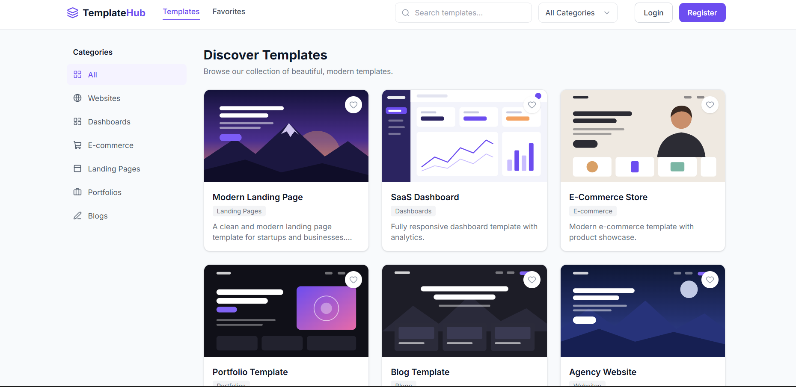
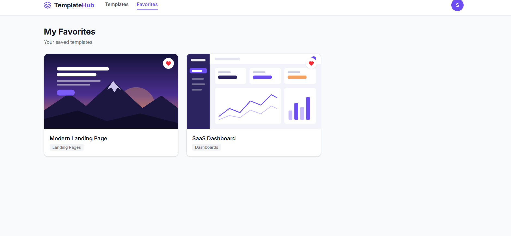
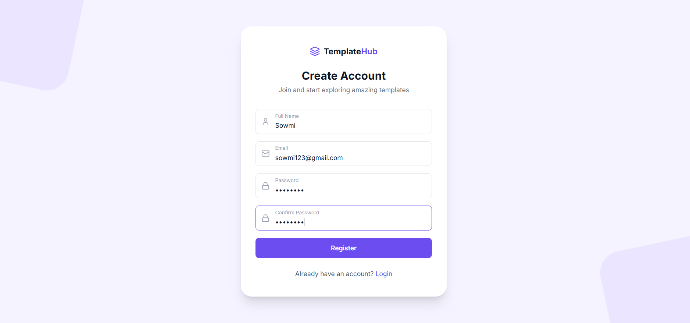

# TemplateHub

TemplateHub is a full-stack template marketplace where users can explore templates, search by category, create an account, log in, and save favorite templates.

## Features

- User registration and login
- Password hashing and JWT authentication
- Browse templates by category
- Search and filter templates
- Add and remove favorite templates
- PostgreSQL database
- Responsive React interface

## Tech Stack

- Frontend: React, Vite, Tailwind CSS
- Backend: Node.js, Express.js
- Database: PostgreSQL
- Authentication: JWT and bcrypt

## Screenshots

### Templates Page


### Favorites Page


### Registration Page


## Run Locally

### Backend
```bash
cd server
npm install
npm run migrate
npm run seed
npm run dev
```

### Frontend
```bash
cd client
npm install
npm run dev
```

## Author

Developed as a full-stack developer intern assignment.